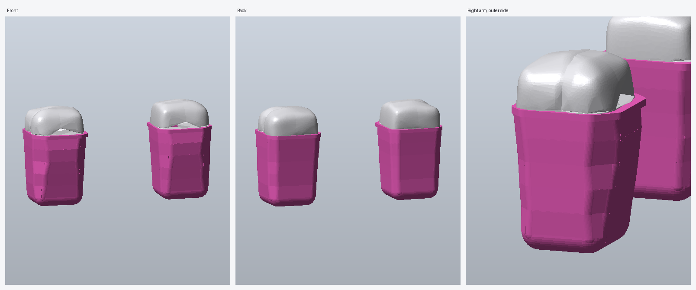

# Muscular arms with gloves

`arms-with-gloves.rbxm` is the "Extremly Muscular" arm morph (`source/arms.rbxm`) with a pair
of thin, pink, opera-length gloves. They run from the fingertips to halfway up the upper arm,
following the arm's shape about 0.02–0.03 studs off the skin, and finish in a small hem at the
opening.



*(Preview: the white arm shape is rebuilt from the mesh's collision data, so its creases are
approximate. In Studio it renders with the real mesh.)*

## Using it

Drag `arms-with-gloves.rbxm` into Studio (or right-click a folder → Insert from File) and use
it wherever the original arms went. Nothing else changes:

- The gloves are plain Parts named `Glove` (and `GloveHem` for the band at the opening),
  132 per arm. They sit directly inside `BodyRightArm` / `BodyLeftArm`, next to `color5` and
  `Middle`.
- Each one is already welded to `Middle`, the same way as the arm mesh. If your morph script
  re-welds every part in the arm model to `Middle`, it also picks up the gloves correctly.
- They're unanchored, `CanCollide`/`CanTouch`/`CanQuery` off and `Massless`, so they don't
  affect character physics.

To recolor them, select every `Glove` and `GloveHem` part in the Explorer and change `Color`.
They're SmoothPlastic, so the separate pieces blend into one surface. A textured material like
Fabric would show the seams between pieces.

## How the gloves were fitted

The arm meshes themselves are hosted on Roblox, but the file stores each MeshPart's collision
hulls (`PhysicalConfigData`), including about 6,600 surface vertices per arm.
`tools/gloves/fit.py` rebuilds the arm's surface from them and measures its cross-section all
the way up. It then builds the glove as:

- a rounded cap over the hand,
- a tapered tube with an eight-sided, rounded cross-section that follows the arm's sides and
  corners (five segments of tilted panels and corner cylinders),
- a straight hem at the opening.

`verify.py` then checks the written file against the glove's real outer surface:
- every weld reproduces its part's position,
- every point of the arm up to the opening is covered with at least 0.012 studs of clearance,
- nothing sticks out above the opening.

Rebuild from the original (needs `cargo`, plus Python with `tools/gloves/requirements.txt`):

```sh
tools/gloves/build.sh
```

The glove length, thickness, color and material are at the top of `fit.py`.
