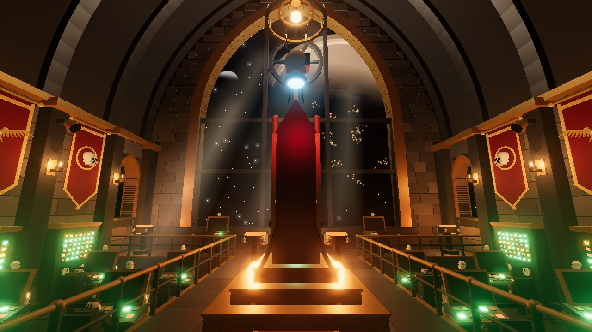
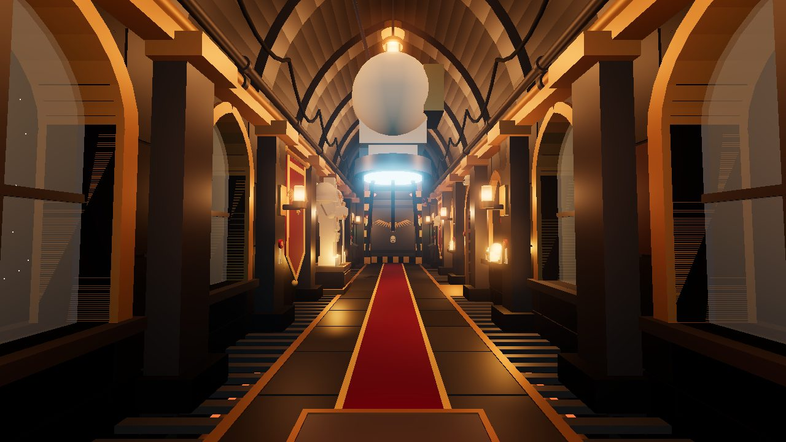
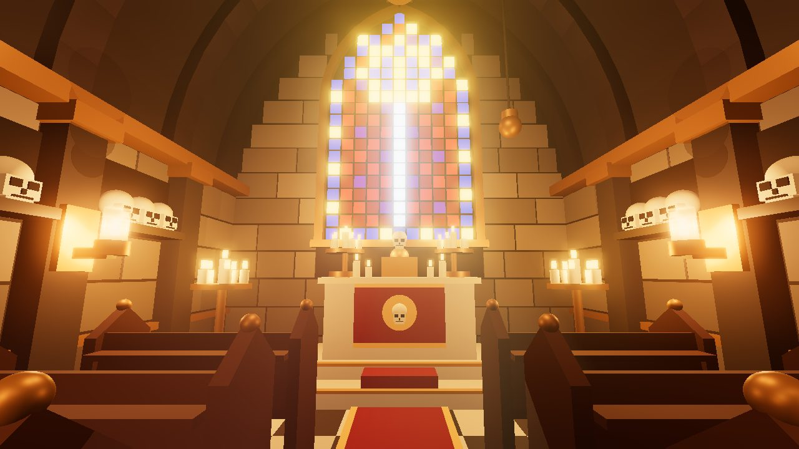
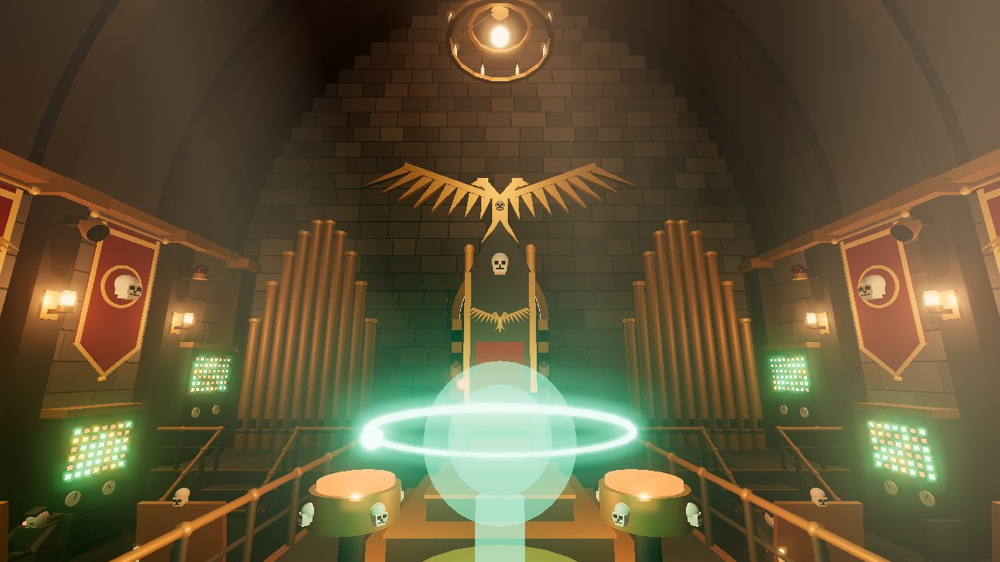
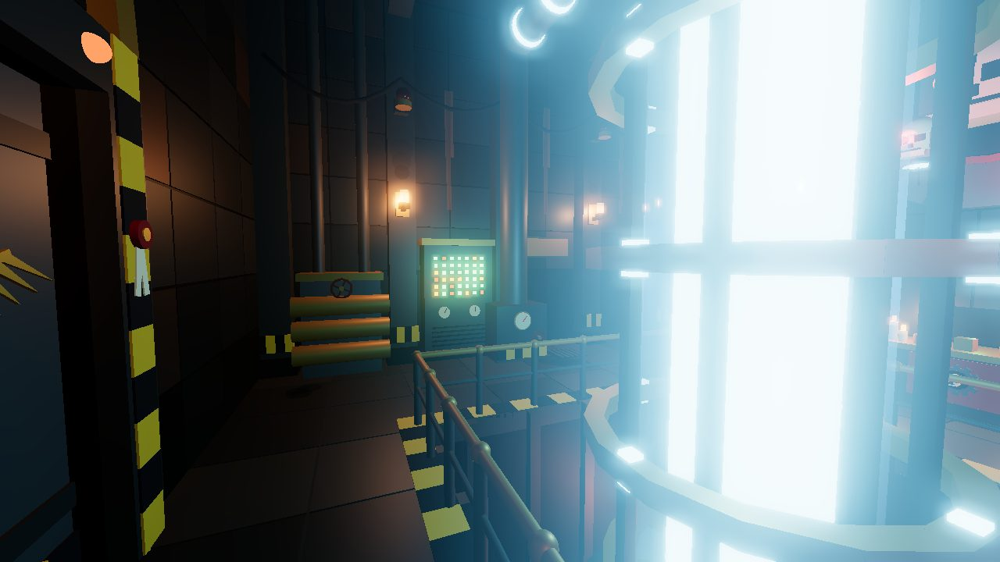
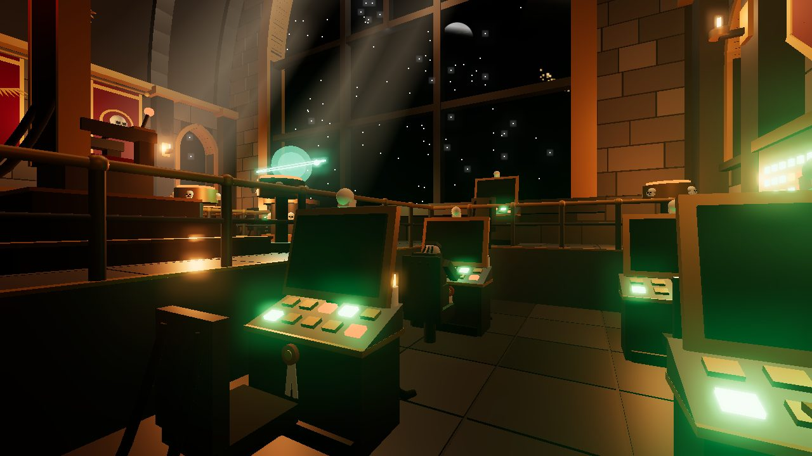

# Imperial Frigate Interior for Roblox

A small, gothic Warhammer 40,000-style starship interior for Roblox: a vaulted
processional corridor, a cathedral-like command bridge, a chapel, and a plasma
enginarium. Everything is built from plain parts. It uses no meshes, decals or
asset IDs, so nothing can be moderated away or fail to load.



| | |
|---|---|
|  |  |
|  |  |
|  | |

*These images come from an approximate offline renderer (three.js), not Roblox
itself. In Studio, materials and Future lighting will look somewhat different.
The renderer can't show particles (haze, dust, steam) or on-screen text, and it
leaves out the viewport glass.*

## Open it

* **Whole place:** open `dist/ImperialShip.rbxl` in Roblox Studio and press
  **Play**. Lighting, sky and post-processing are already set up.
* **Into your own place:** drag `dist/ImperialShip.rbxm` into the Studio
  viewport, or right-click *Workspace → Insert from File*. It is
  self-contained and includes its own spawn point and scripts. For the intended mood, use the place's lighting
  settings: `Lighting.Technology = Future`, `ClockTime = 0`, a `Sky` with stars,
  plus `BloomEffect` and `ColorCorrectionEffect`.
  See [`default.project.json`](default.project.json) for the exact values.

You spawn in the corridor facing the bridge.

## Making it look real

The ship is meant to look used rather than freshly built:

* **Masonry and plating.** The bridge and chapel walls are faced with
  individual stone blocks (staggered courses and mortar joints, slate on the
  bridge, limestone in the chapel). The corridor and enginarium are clad in
  separate hull plates with dark seams and diamond-plate kick panels. Every
  block and plate has its own slight colour variation, and the lower courses
  are darker with grime.
* **Weathering.** Lamps leave soot plumes on the walls above them, the
  enginarium plating has rust patches and streaks, and there are glossy oil and
  condensation puddles on the decks. Floors are separate worn deck plates.
* **Light.** Lamps are frosted-glass shades around a small glowing filament
  instead of solid neon blobs, in warm tungsten colours. Hard sunlight comes
  through the viewport, so its tracery casts shadows. You can see light shafts
  in the haze from the viewport and the stained glass, along with drifting dust
  motes that only show where light falls. Thin incense and steam haze hangs in
  every room. Bloom and colour grading are toned down.
* **The view.** The hive world and its moon are shaded discs rather than flat
  glowing balls. The planet shows a thin sunlit crescent with a hazy
  atmospheric rim, and clusters of hive-city lights across its night side. The
  shading matches the sunlight coming through the window.
* **Lived-in details.** Hardwired servitors are bent over half the bridge
  consoles. Consoles carry candle stubs and purity seals. There are stencilled
  deck markings and frame numbers, conduit flanges, red valve wheels, vox-caster
  horns, and doors that vent steam when they open.

## What's aboard

| Area | Highlights |
|---|---|
| **Corridor** | Ribbed pointed vault, grated gutters with underglow, lancet windows onto the void, skull niches, banners, a marble Space Marine statue, cogitator terminals, a patrolling servo-skull |
| **Bridge** | Three-lancet viewport with a rose window looking out on a hive world and its moon. Also: command throne on a stepped dais, green-glowing hololith, sunken servitor pits of crewed cogitators, blinking cogitator stacks, braziers, chandeliers, organ pipes and a great golden aquila |
| **Chapel** | Pews, ossuary shelves of honoured crew, altar and reliquary, candelabra, an incense censer and a stained-glass lancet (sword in halo) |
| **Enginarium** | Plasma reactor rising from a pit, with spinning containment rings, ceiling conduits, steam vents, warning beacons and a Mechanicus shrine with a Cog Mechanicus |

### Interactive bits

* **Blast doors** slide up into the bulkhead when you approach, venting steam.
  Their lamps turn green while they're open.
* **Command throne:** pull the red lever on its right armrest (*Sound General
  Quarters*). Lumens turn red and pulse, beacons spin, and the cogitators start
  scrolling alarms. Pull it again to stand down.
* **Chapel kneeler:** *Pray*, and the candles flare.
* **Machine altar:** *Anoint the Machine Spirit*, and the reactor surges
  white-hot while its rings spin up.
* The throne, the empty servitor seats and the pews are all sittable `Seat`s.

## How it works

```
src/ShipBuilder/          geometry: plain Roblox code, no runtime dependencies
  init.luau               ShipBuilder.build(parent) -> Model
  Layout.luau             deck plan and shared dimensions
  Kit.luau                part helpers, gothic arch maths, walls with openings
  Surface.luau            masonry/plating cladding, deck plates, soot, rust, puddles, stencils
  Props.luau              skulls, servo-skulls, aquila, cog, doors, cogitators, servitors...
  Corridor/Bridge/Chapel/Enginarium.luau
src/ShipScripts/
  ShipSystems.server.luau doors + proximity prompts (sets attributes)
  ShipAmbience.client.luau all animation, client-side (reads attributes)
scripts/build.luau        Lune: bakes dist/ImperialShip.rbxm, then runs Rojo
default.project.json      Rojo place: the baked model + lighting
```

The builder only uses `Instance.new` and Roblox datatypes. That means
[Lune](https://github.com/lune-org/lune) can run it unchanged outside Roblox
and save the result as a model file. Both runtime scripts live inside the
model:

* `ShipSystems` (server) only sets attributes: `Open` on each door, and
  `RedAlert`, `BlessingAt` and `SurgeAt` on the ship.
* `ShipAmbience` (`RunContext = Client`) reads those attributes and animates
  everything locally, so the server does no per-frame work.

Things opt in to effects through an `Fx` attribute, such as `Lumen`, `Candle`,
`ServoSkull`, `Spin`, `Beacon` or `Cogitator`. To make a new part flicker, give
it `Fx = "Lumen"` and a `Flicker` value.

The model has about 8,200 parts and 85 lights, plus a few light-shaft beams and
low-rate particle emitters for haze and dust. It's set to
`ModelStreamingMode = Persistent`, so streaming won't unload parts of it. On
low-end devices, delete the `HazeVolume` and `DustVolume` parts if particles
cost too much.

## Rebuild from source

You need [Rokit](https://github.com/rojo-rbx/rokit). Then run:

```sh
rokit install            # rojo, lune, stylua (versions in rokit.toml)
lune run scripts/build   # writes dist/ImperialShip.rbxm and dist/ImperialShip.rbxl
```

Run `lune run scripts/build model` to bake just the `.rbxm`. You can also keep
Studio in sync with `rojo serve` while you iterate.

## Ideas for next steps

* Ambient sound: an engine hum, vox chatter and a general-quarters klaxon.
  Upload your own audio and play it from `ShipAmbience`.
* More decks: an armorium, the Navigator's sanctum, or a gun deck with
  macrocannons.

---

This is an unofficial fan project and is not affiliated with Games Workshop.
Warhammer 40,000 and related names are trademarks of Games Workshop Ltd. No
Games Workshop assets are used.
